<div align="center">


# SEÑAS — Filipino Sign Language Learning Platform

**An interactive mobile application for learning Philippine Sign Language (FSL)**  
powered by real-time AI hand gesture recognition

[](https://reactnative.dev/)
[](https://expo.dev/)
[](https://www.typescriptlang.org/)
[]()
[]()

</div>

---

## About SEÑAS

**SEÑAS** (derived from the Filipino word for *signs*) is a gamified, AI-powered mobile learning platform that makes Philippine Sign Language (FSL) accessible to everyone. Whether you are a beginner exploring FSL for the first time or a student building fluency, SEÑAS guides you through structured lessons, real-time gesture feedback, challenges, and adaptive learning — all from your smartphone.

> *Bridging the communication gap between the hearing and Deaf communities in the Philippines.*

---

## Key Features

| Feature | Description |
|---|---|
|  **Real-Time Gesture Detection** | Live hand recognition via MediaPipe + TFLite model — camera overlay checks your signs instantly |
|  **Structured Lessons** | Curriculum-based modules: Alphabet, Numbers, Greetings, Survival Signs |
|  **Adaptive Learning** | Personalized review paths based on mastery scores and weak skill detection |
|  **Achievements & XP** | Earn experience points, badges, and certificates as you progress |
|  **Daily Streaks & Challenges** | Daily login streaks and time-limited challenges to keep learners engaged |
|  **Drag & Drop Quizzes** | Interactive drag-and-drop sign matching exercises |
|  **Master Mode** | High-difficulty challenge mode unlocked after completing all standard levels |
|  **Sign Reference Images** | Built-in visual sign reference gallery (Alphabet, Greetings, Survival) |
|  **Leaderboard** | Competitive rankings among learners |
|  **Certificates** | Downloadable completion certificates upon module mastery |
|  **Push Notifications** | Lesson reminders and streak alerts via Expo Notifications |
|  **Dark / Light Mode** | Full theme support with system-preference detection |
|  **Offline Awareness** | Network detection banner to handle connectivity |

---

## App Demo

### Startup Screen
The first screen users see — introducing SEÑAS with its brand identity and entry point to login or onboarding.

<div align="center">
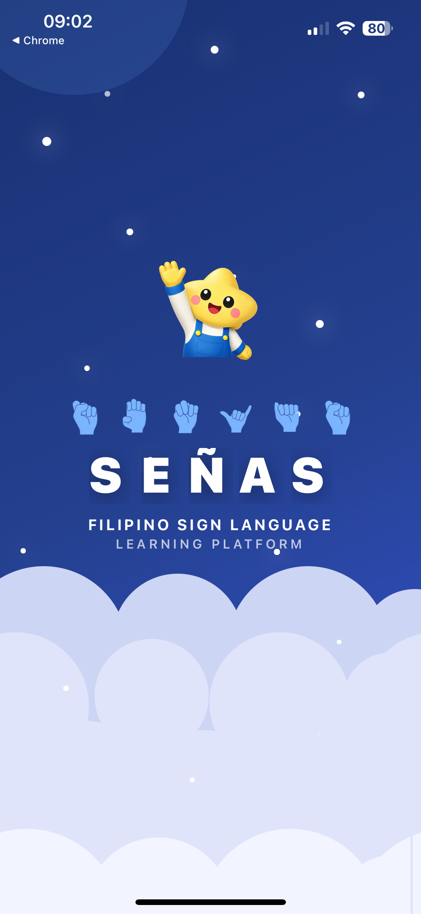
</div>

---

### Dashboard
The learner's home hub — shows daily streak, XP progress, quick-access lesson cards, and upcoming challenges.

<div align="center">
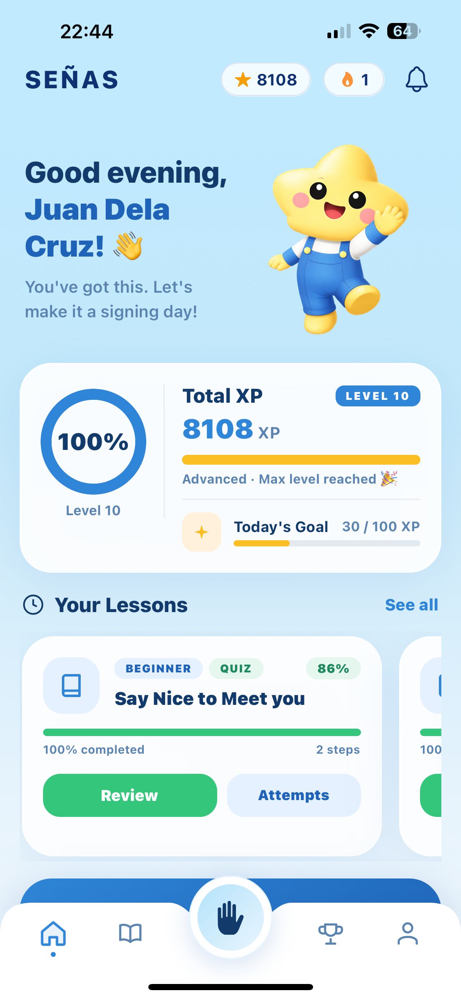
</div>

---

### Lessons
Browse the full lesson library organized by module. Track your completion progress and jump into any lesson.

<div align="center">
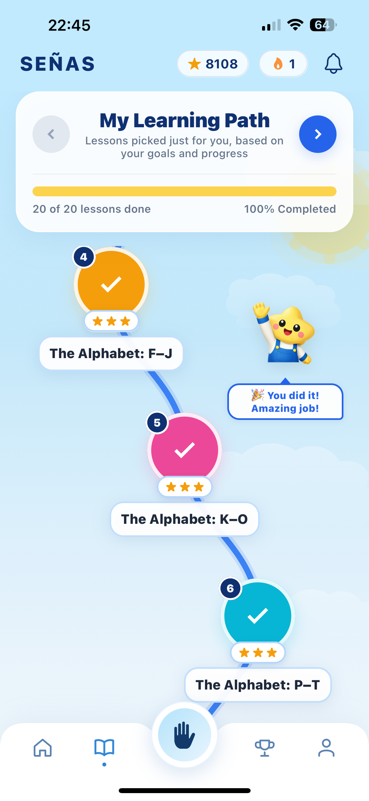
</div>

---

### Performing a Sign
When a lesson requires you to demonstrate a sign, the camera activates and waits for your gesture. The AI model evaluates your hand shape in real time.

<div align="center">
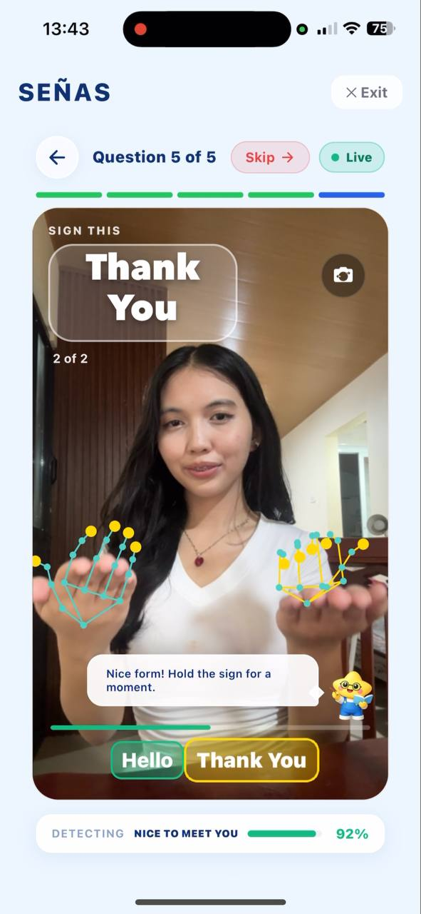
</div>

---

### Hand-in-Frame Detection
If the camera cannot detect a hand, SEÑAS shows a friendly overlay prompting the user to show their hands before recognition begins. No false positives — the model only scores when a hand is properly detected.

<div align="center">
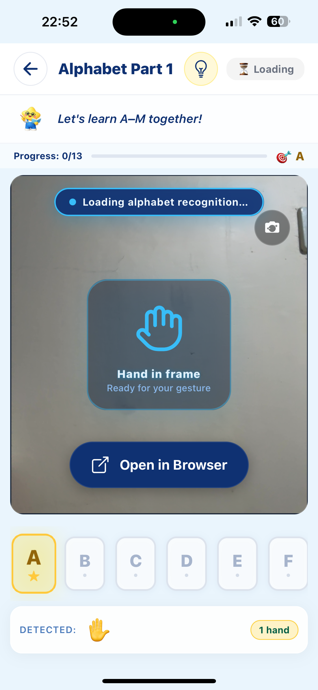
&nbsp;&nbsp;&nbsp;
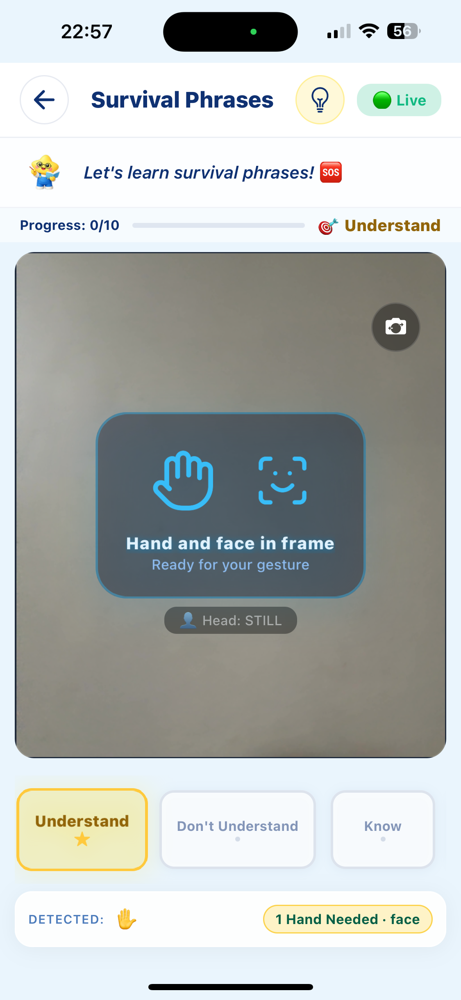
</div>

---

### Drag & Drop Quiz
An engaging drag-and-drop interaction where learners match signs to their meaning — reinforcing vocabulary in a playful way.

<div align="center">
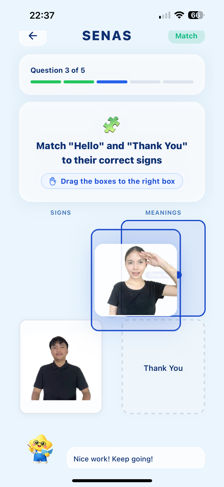
</div>

---

### Sign Reference Images
Built-in visual sign galleries let learners study hand shapes before attempting them. Covers **Alphabet**, **Greetings**, and **Survival** signs.

<div align="center">
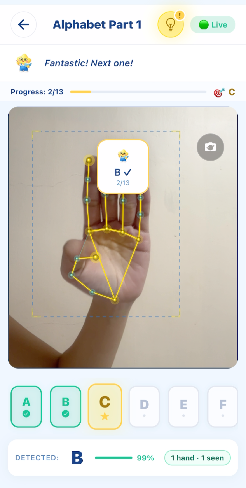
&nbsp;&nbsp;&nbsp;
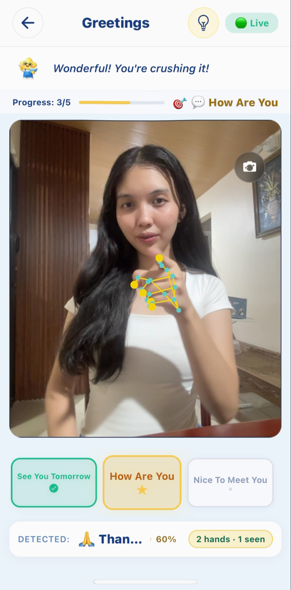
&nbsp;&nbsp;&nbsp;
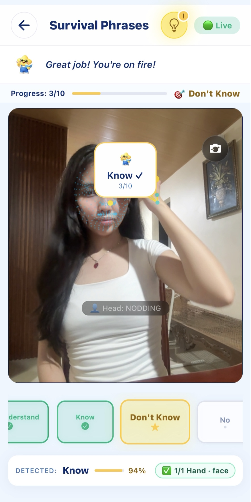
</div>

---

### Challenge Modes & Master Mode
Multiple challenge modes push learners beyond structured lessons. **Master Mode** is a high-difficulty endurance challenge unlocked after completing all modules.

<div align="center">
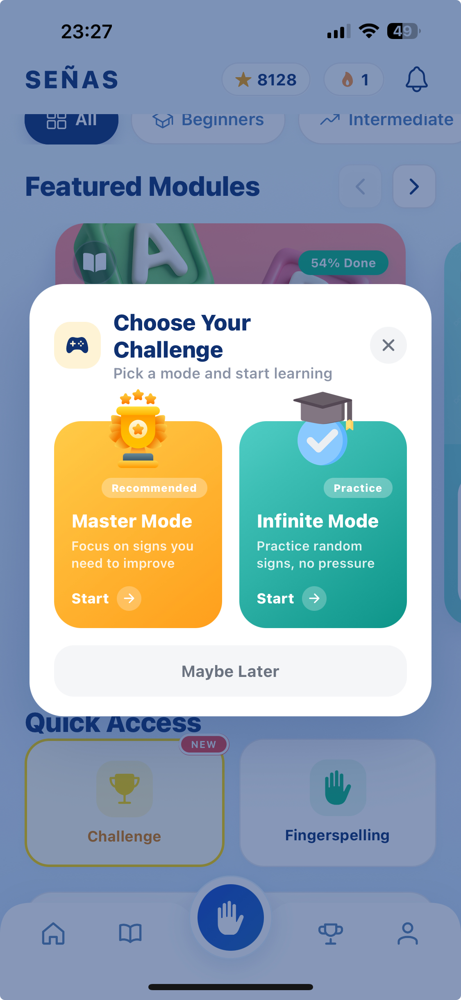
</div>

---

### Adaptive Learning
The platform identifies signs you struggle with and automatically surfaces them in targeted review sessions — powered by mastery tracking on the backend.

<div align="center">

</div>

---

### Daily Challenges
Timed daily challenges keep learners returning every day. Complete them to earn bonus XP and maintain your streak.

<div align="center">
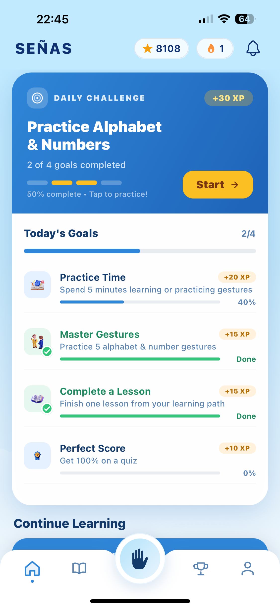
</div>

---

### Streak Tracker
Visual streak tracking motivates consistency — lose it and you start over, keep it and earn streak-based rewards.

<div align="center">
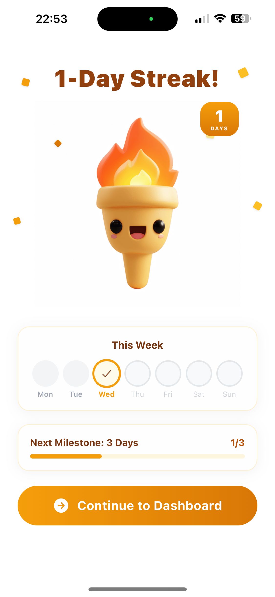
</div>

---

### Achievements
Unlock badges for completing modules, maintaining streaks, scoring perfectly, and reaching milestones.

<div align="center">
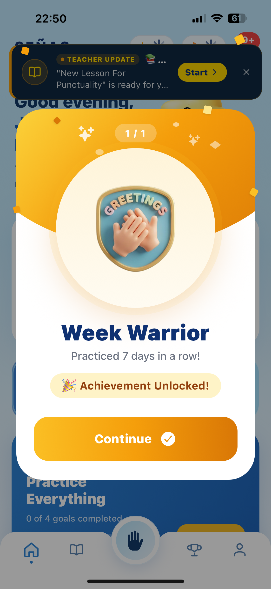
</div>

---

### Leaderboard
Compete with other learners on a global leaderboard ranked by XP — fostering healthy motivation and community.

<div align="center">
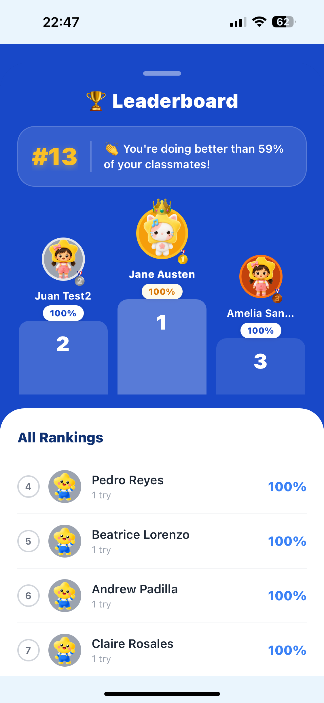
</div>

---

### Certificate
Earn a shareable, printable certificate upon completing a module — a tangible reward for your effort.

<div align="center">
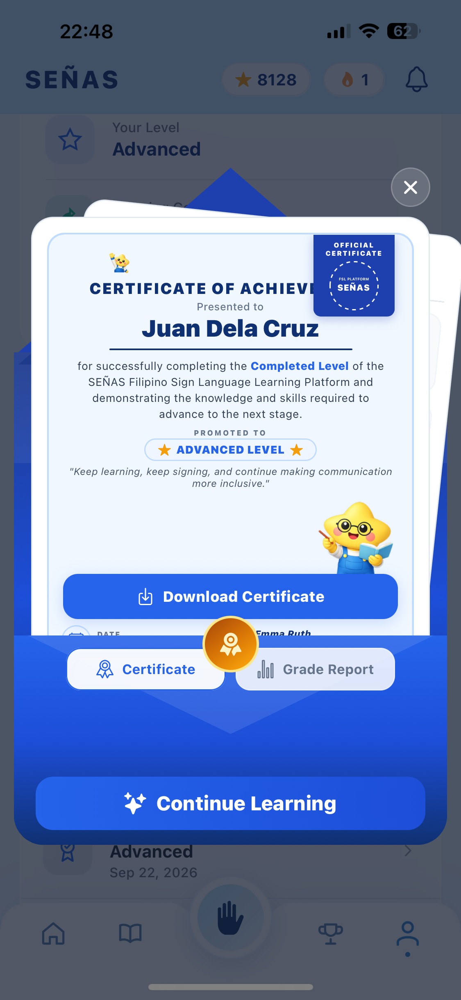
</div>

---

### Profile
Personal profile page showing your stats, XP, completed modules, and account settings.

<div align="center">
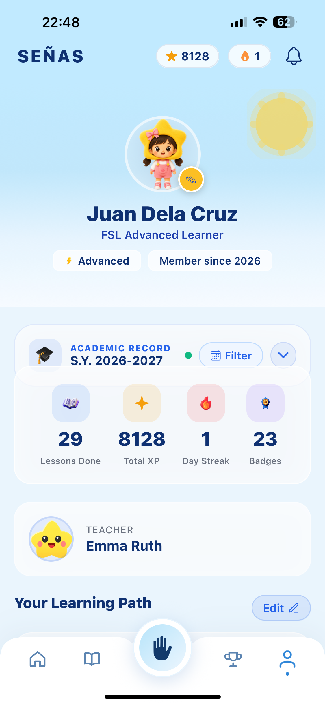
</div>


## Tech Stack

### Mobile App (This Repo)

| Category | Technology |
|---|---|
| **Framework** | [React Native 0.81.5](https://reactnative.dev/) + [Expo SDK 54](https://expo.dev/) |
| **Language** | TypeScript 5.9 / JavaScript (ES2022) |
| **Navigation** | [Expo Router 6](https://expo.github.io/router/) (file-based routing) |
| **UI & Animation** | React Native Reanimated 4, React Native Gesture Handler, Expo Linear Gradient, Expo Blur |
| **Camera** | Expo Camera 17, React Native WebView (MediaPipe bridge) |
| **ML Inference (On-Device)** | [react-native-fast-tflite](https://github.com/mrousavy/react-native-fast-tflite) with CoreML (iOS) + GPU delegates (Android) |
| **ML Inference (Server)** | MediaPipe Hands (via WebView ↔ backend bridge) |
| **Icons** | @expo/vector-icons, Lucide React Native |
| **Storage** | AsyncStorage (local), Expo File System |
| **Notifications** | Expo Notifications |
| **Video / Audio** | Expo AV, Expo Video, React Native Video |
| **Networking** | Native Fetch API with in-memory cache, deduplication & retry logic |
| **Offline Detection** | @react-native-community/netinfo |
| **Confetti / Effects** | react-native-confetti-cannon |
| **Build & Deploy** | [EAS Build](https://docs.expo.dev/eas-build/introduction/) (Expo Application Services) |
| **New Architecture** | Enabled (React Native Nitro Modules, React Compiler) |

### Backend (Separate Repo)

> This mobile app communicates with a dedicated backend server hosted at `https://señas.tech/api`.  
> The backend is responsible for ML model serving, user data management, adaptive learning logic, and leaderboard computation.

| Category | Role |
|---|---|
| **REST API** | Lesson content, user progress, achievements, leaderboard |
| **ML Model Serving** | Gesture classification models (FSL hand signs) |
| **Adaptive Engine** | Mastery tracking, weak skill identification, learning path generation |
| **Auth** | Token-based authentication (JWT) |
| **Storage** | User media, certificates, lesson assets |

---

## How Gesture Recognition Works

```
User performs a sign
        │
        ▼
  📷 Device Camera (expo-camera)
        │
        ▼
  🌐 WebView Bridge ──────────────────► 🖥️ Backend Server
  (MediaPipe Hands JS)                  (ML Model Inference)
        │                                       │
        │◄──────────────────────────────────────┘
        │  Prediction result (sign label + confidence)
        ▼
  ✅ App evaluates result
  → Correct: XP awarded, next sign
  → Incorrect: Hint shown, retry
  → No hand: HandDetectionGuideOverlay shown
```

The `HandDetectionGuideOverlay` component activates when the camera feed does not detect a hand landmark, instructing the user to properly position their hand in frame before scoring begins.

---

## Getting Started

### Prerequisites

- Node.js ≥ 18
- Expo CLI (`npm install -g expo-cli`)
- iOS Simulator (macOS) or Android Emulator / physical device
- EAS CLI for builds (`npm install -g eas-cli`)

### Installation

```bash
# Clone the repository
git clone https://github.com/your-org/senas-mobile-app2.git
cd senas-mobile-app2

# Install dependencies
npm install

# Start the development server
npx expo start
```

### Running on Device

```bash
# iOS
npx expo run:ios

# Android
npx expo run:android
```

> **Camera and gesture features require a physical device.** The iOS Simulator and Android Emulator do not support camera input.

### Environment

The app reads its backend URL from `app.json` extras:

```json
"extra": {
  "apiUrl": "https://señas.tech/api",
  "storageUrl": "https://señas.tech/storage",
  "webUrl": "https://señas.tech"
}
```

---

## 📂 Gesture Modules

| Module | Signs | Description |
|---|---|---|
| **Alphabet** | A – Z (26 signs) | Filipino Sign Language fingerspelling alphabet |
| **Numbers** | 1 – 10 | Numeric hand signs |
| **Greetings** | 5 signs | Hello, Thank You, See You Tomorrow, How Are You, Nice To Meet You |
| **Survival** | 10 signs | Understand, Know, Yes, No, Correct, Wrong, Slow, Fast, and more |
| **Master Mode** | All modules | Endurance challenge across all learned signs — no hints, full speed |

---

## Gamification System

```
XP Points ──► Level Progress ──► Mastery Badges
     │                                  │
     ▼                                  ▼
Daily Streaks              Achievement Unlocks
     │                                  │
     ▼                                  ▼
Leaderboard Ranking         Completion Certificates
```

- **XP** is earned for every correct sign, completed lesson, and daily challenge
- **Mastery** is tracked per sign — the adaptive engine surfaces low-mastery signs for review
- **Streaks** reset if you miss a day — push notifications remind you daily
- **Certificates** are generated and sharable/printable via Expo Print & Sharing

---

## 🛡️ Permissions

| Permission | Purpose |
|---|---|
| `CAMERA` | Real-time hand gesture detection during lessons |
| `NOTIFICATIONS` | Daily lesson reminders and streak alerts |
| `INTERNET` | Backend API communication for lessons and progress sync |

---

## 👩‍💻 Development Notes

- **New Architecture** is fully enabled (`newArchEnabled: true`) with React Native Nitro Modules and the React Compiler experiment active
- **TFLite** runs on-device with **CoreML delegate** on iOS and **GPU delegate** on Android for accelerated inference
- **WebView bridge** is used for MediaPipe Hands (JavaScript) to communicate gesture predictions back to the native layer via `postMessage`
- **Smart API caching** in `services/api.js` deduplicates concurrent requests and applies per-endpoint TTLs to minimize backend load
- **Offline support** via `@react-native-community/netinfo` with a persistent `OfflineBanner` component

---

## 📄 License

This project is private and proprietary. All rights reserved © SEÑAS Team.

---

<div align="center">

Made with 🤟 for the Filipino Deaf Community

**SEÑAS** — *Salamat, mahal namin kayo!*

</div>
